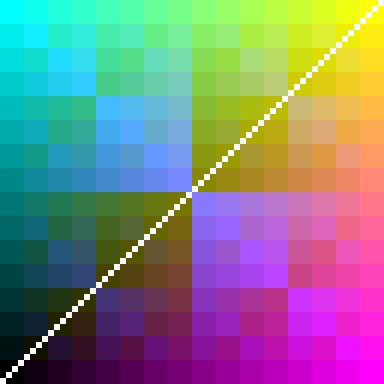

# PIX6

PIX6 is a small computer that draws on the 64 x 64 screen (`RGB DISPLAY 64`). Like every RHDL example it is built from NAND gates; only the program ROM and the screen are built-in chips. It is fast enough for games: the **Snake** project that comes with Rewired runs on it.

## Architecture

- X and Y registers: the pen position, 0 to 63, wrapping around
- two spare pens, B and F, that `SWAP` exchanges with the pen
- colour register: 4 bits each of red, green and blue
- direction register for games, set from the `KEYS` input (bit 0 right, 1 up, 2 left, 3 down)
- delay counter T, grow counter G and a 16-bit random number generator
- the colour the screen shows at the pen comes back on `SCREEN_R/G/B`, so a program can read the screen
- 8-bit program counter: up to 256 instructions in the stock ROM
- 16-bit instruction word `OAAA`: opcode `O`, argument `AAA`
- one instruction per rising clock edge
- synchronous reset: X, Y, colour and PC start at 0

Build these in order:

1. `../Basics/04_DFF.rhdl`
2. `../Basics/05_REG4.rhdl`
3. `00_REG8.rhdl`
4. `01_PIX6.rhdl` (the processor)
5. `02_PIX6_COMPUTER.rhdl` (the processor wired to the screen)
6. `03_SNAKE.rhdl` (the processor, the screen, a clock and keys, as in the Snake project)

Then type a program into the ROM inside `Pix6`, open `Pix6Computer`, pulse `RESET` and run the clock.

## Instructions

| Word | Instruction | Effect |
| --- | --- | --- |
| `0000` | NOP | nothing |
| `10nn` | SETX n | X <- n |
| `20nn` | SETY n | Y <- n |
| `3RGB` | SETC rgb | colour <- RGB, e.g. `3F00` is red, `3FFF` white |
| `4RGB` | ADDC rgb | colour <- colour + RGB (12-bit, wraps) |
| `5000` | PLOT | draw the colour at (X, Y) |
| `6000` | INCX | X <- X + 1 |
| `7000` | INCY | Y <- Y + 1 |
| `80aa` | JMP a | jump to address a |
| `90aa` | JXNZ a | jump if X != 0 |
| `A0aa` | JYNZ a | jump if Y != 0 |
| `B000` | PAT | colour <- red from X, green from Y, blue from X xor Y |
| `C000` | SHOW | show everything drawn so far |
| `D000` | CLS | clear the drawing (the shown picture stays until SHOW) |
| `E000` | PLOTX | PLOT, then INCX: draws a row in one instruction per pixel |
| `F000` | HLT | stop until RESET |

Opcode 0 holds the instructions added for games. `0000` is still NOP:

| Word | Instruction | Effect |
| --- | --- | --- |
| `0100` / `0101` | SWAP B / SWAP F | exchange the pen with pen B / pen F |
| `0200` | TURN | direction <- next direction |
| `0300` | STEP | move the pen one pixel in the direction |
| `0400` | STEPC | move the pen in the direction held in colour bits 0-1 |
| `0500` | READ | colour <- colour shown at the pen |
| `0600` | DCOL | colour bits 0-1 <- direction |
| `0700` | ERASE | draw black at the pen |
| `0800` | KEYS | next direction <- pressed key, unless it reverses the direction |
| `09aa` | JKEY a | jump if a key is pressed |
| `0A00` | RND | pen <- random position |
| `0Baa` | JCZ a | jump if colour == 0 |
| `0Cnn` | SETT n | T <- n * 16 |
| `0Daa` | DJNZ a | T <- T - 1, jump if T != 0 |
| `0Enn` | GROW n | G <- G + n |
| `0Faa` | JGROW a | if G != 0: G <- G - 1 and jump |

Compare the colour with a value by adding its negative: after `ADDC 0x100`, `JCZ` jumps if the colour was `F00`.

`nn` is a number from `00` to `3F`; `aa` is a ROM address. The screen is double-buffered: drawing is invisible until `SHOW`, so a picture appears at once instead of pixel by pixel.

Because X and Y wrap around at 64, `JXNZ` right after `INCX` or `PLOTX` loops exactly once over a whole row, and `JYNZ` after `INCY` over the whole screen.

## Program 1: colour pattern with a white diagonal

| Address | Word | Instruction |
| ---: | ---: | --- |
| 0 | `B000` | PAT |
| 1 | `E000` | PLOTX |
| 2 | `9000` | JXNZ 0 |
| 3 | `7000` | INCY |
| 4 | `A000` | JYNZ 0 |
| 5 | `3FFF` | SETC FFF |
| 6 | `5000` | PLOT |
| 7 | `6000` | INCX |
| 8 | `7000` | INCY |
| 9 | `9006` | JXNZ 6 |
| A | `C000` | SHOW |
| B | `F000` | HLT |

The first loop fills all 4096 pixels with the pattern (red grows to the right, green upwards, blue in an XOR checkerboard), the second draws the diagonal from (0, 0) to (63, 63). The picture appears after 12 675 clock cycles and `HALTED` goes high:

## Program 2: moving dot

| Address | Word | Instruction |
| ---: | ---: | --- |
| 0 | `3F80` | SETC F80 (orange) |
| 1 | `D000` | CLS |
| 2 | `5000` | PLOT |
| 3 | `C000` | SHOW |
| 4 | `6000` | INCX |
| 5 | `7000` | INCY |
| 6 | `8001` | JMP 1 |

Every six clock cycles one frame is shown: an orange dot that moves diagonally and wraps around the screen.

## Snake

[`snake.pix6`](snake.pix6) is a Snake game in 70 instructions. Rewired installs it as the **Snake** project the first time it starts: open the project, and the game runs.

- **W A S D** steer, **R** starts again. On a phone, hold a finger on the key chips.
- Eat the red food to grow by three. Hitting a wall or yourself ends the game; press any direction to play again.
- The screen is the game's only memory. Every body pixel is green, and the low two bits of its blue channel hold the direction to the next segment. The tail reads its pixel, erases it and follows that direction, so the snake can grow to any length.
- Speed: the word at the label `frame` (`SETT 40`) sets the delay between moves. The project runs at 8000 simulation steps per second (Preferences), which is 4000 instructions per second.

The program is written in PIX6 assembly. The assembler used by the tests (`Assets/Tests/EditMode/Pix6Assembler.cs`) turns it into ROM words; after changing it, rebuild the bundled project as described in `Assets/Tests/EditMode/BundledProjectTests.cs`.
