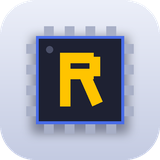
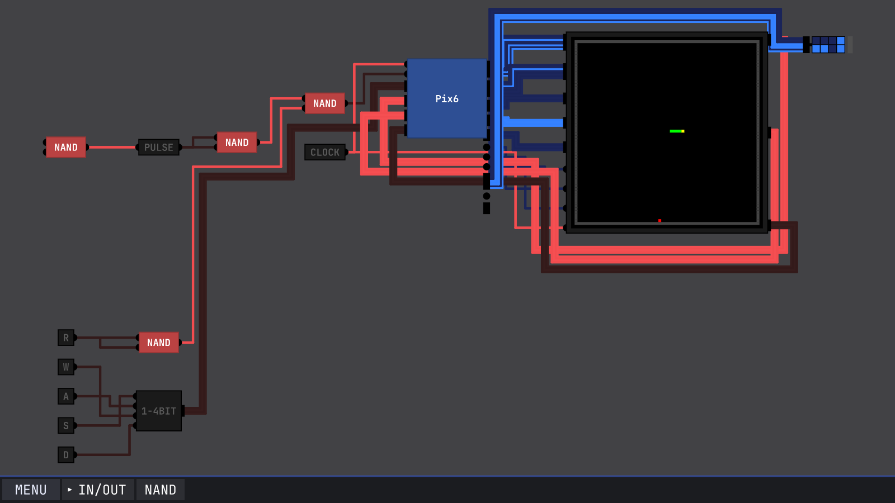
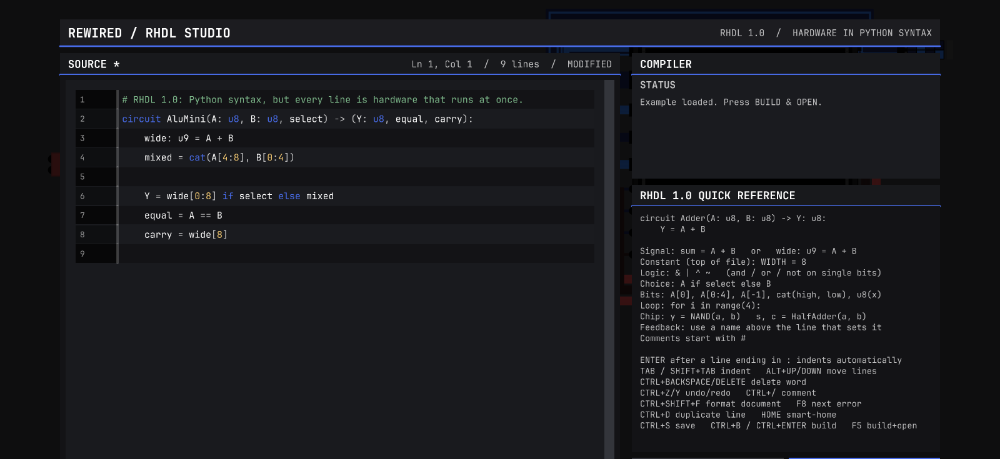
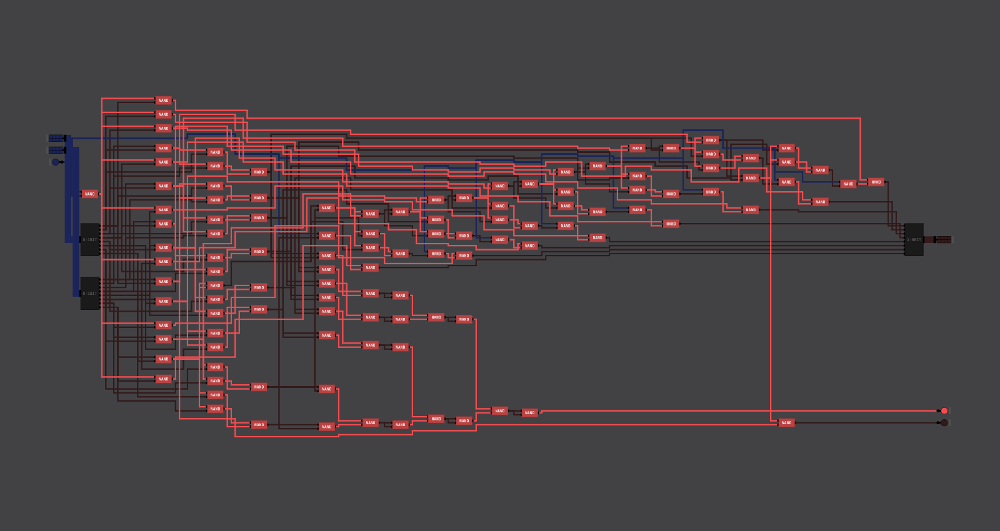
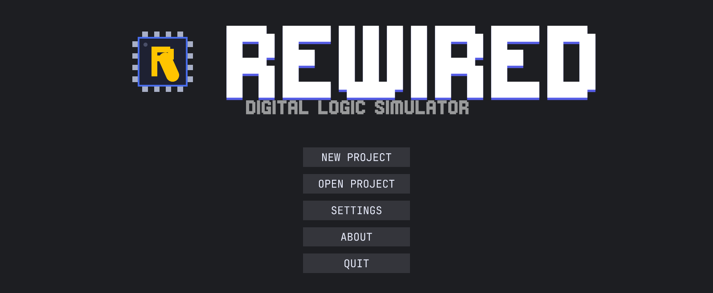

<p align="center"></p>

<h1 align="center">Rewired — Digital Logic Simulator</h1>

<p align="center">
<b>Build logic gates, adders, registers, RAM and whole CPUs from NAND gates — then play Snake on the computer you built.</b><br>
Free and open source · Windows · Linux · Android · MIT licence
</p>

<p align="center">
<a href="https://github.com/patyczak232323/Rewired/releases/latest"><b>⬇ Download the latest release</b></a> ·
<a href="Docs/GETTING_STARTED.md">Getting Started</a> ·
<a href="Docs/RHDL_GUIDE.md">RHDL Guide</a> ·
<a href="Examples/RHDL/">Examples</a>
</p>

<p align="center">
<a href="https://github.com/patyczak232323/Rewired/releases/latest"></a>
<a href="https://github.com/patyczak232323/Rewired/releases"></a>
<a href="https://github.com/patyczak232323/Rewired/actions/workflows/simulation-regression.yml"></a>
<a href="https://github.com/patyczak232323/Rewired/actions/workflows/unity-tests.yml"></a>
<a href="LICENSE"></a>
<a href="https://github.com/patyczak232323/Rewired/stargazers"></a>
</p>

<p align="center"></p>
<p align="center"><i>The Snake project that ships with Rewired: a small processor made of logic gates, a 64×64 screen and four keys.</i></p>

**Rewired** is a free, open-source **digital logic simulator** and **logic gate circuit simulator** for learning **digital electronics**, **Boolean logic** and **computer architecture**. Start with a single NAND gate, build your own chips, and keep going until you have an ALU, registers, RAM and a working CPU. Rewired is a desktop and Android app built with Unity, with a deterministic, JIT-accelerated simulation engine and **RHDL**, a small **hardware description language** with Python syntax that turns source code into gate-level circuits.

Rewired is based on Sebastian Lague's [Digital Logic Sim](https://github.com/SebLague/Digital-Logic-Sim), but uses its own simulation engine and should be treated as an independent simulator rather than a drop-in compatible replacement.

## Screenshots

| Write hardware in Python syntax… | …and get a real gate-level circuit |
|---|---|
|  |  |

<p align="center"></p>

## Who it is for

- **Students** learning logic gates, truth tables, flip-flops and how a CPU works, for example alongside *Nand2Tetris*, *Digital Design and Computer Architecture* or *But How Do It Know?*
- **Teachers** who want a free logic simulator for digital electronics and computer science classes
- **Hobbyists** who want to design an 8-bit computer, build a CPU from scratch or make games that run on their own hardware
- **Players of Digital Logic Sim** who want bigger, faster circuits, a hardware description language and Android support

## What you can build

Rewired is intended for learning and experimenting with **digital electronics, Boolean logic, computer architecture and CPU design**.

You can build:

- logic gates and combinational circuits
- multiplexers, adders and ALUs
- latches, flip-flops and registers
- counters and state machines
- RAM and other gate-level memory structures
- custom reusable chips
- small CPUs and complete computer architectures
- source-generated circuits with RHDL

The repository includes a compact example progression ending with a **4-bit CPU** and a separate **4×4-bit RAM** example.

## Main features

- graphical digital circuit editor
- deterministic event-driven simulation
- compiled circuit/netlist topology
- dirty-gate scheduling
- fixed-point settling for signal propagation
- support for deeply nested Custom Chips
- global Custom Chips shared safely between projects
- combinational JIT acceleration
- feedback JIT for supported cyclic gate networks
- persistent FULL LUT cache for suitable combinational circuits
- simulation diagnostics and profiling
- waveform capture and deterministic replay
- non-convergence diagnostics
- **RHDL 1.0** hardware description language with Python syntax
- truth table for any combinational chip, recordable as a regression test
- breakpoints: pause when a pin changes, rises, falls or reaches a value
- export to structural Verilog, SVG schematics and PNG screenshots
- 64 x 64 colour screen (4 bits per channel, double-buffered) for games and graphics demos
- Snake example project, installed on first start
- updates from GitHub Releases inside the app on Windows, Linux and Android
- Windows x64, Linux x86_64, WebGL (browser) and Android ARM64 (experimental) release builds
- touch interface for Android tablets and phones, held sideways or upright (Settings → Screen): drag parts from a categorised panel, tap a part for its actions, one-finger panning and a step-by-step guide

## Download

The latest prebuilt version is available in **GitHub Releases**:

**[Download the latest Rewired release](https://github.com/patyczak232323/Rewired/releases/latest)**

Release packages:

- Windows x64: `DLSRewired-Windows-x64.zip`
- Linux x86_64: `DLSRewired-Linux-x86_64.zip`
- WebGL (browser): `DLSRewired-WebGL.zip`. **Known issue:** the browser build currently shows an empty grey screen, because the editor draws with indirect instanced rendering, which WebGL does not support. Use a desktop or Android build for now.
- Android ARM64 (experimental): `DLSRewired-Android-arm64.apk`

On Linux, after extracting the archive, the executable may need permission:

```bash
chmod +x DLSRewired
./DLSRewired
```

### Updating

Rewired checks GitHub for a newer release when it starts (turn this off in Settings). The bottom bar of the main menu, or the header on Android, then offers the update:

- **Windows and Linux**: *Update* downloads the release, quits Rewired, copies the new files over the installed ones and starts the new version. If the install folder is not writable, the release page opens instead.
- **Android**: *Update* downloads the new APK and installs it, then Rewired closes; open it again to use the new version. The first time, Android asks to allow installs from Rewired and to confirm the update. After that, Android 12 and newer install updates without asking. Projects are kept.
- **WebGL**: the site is updated by whoever hosts it.

For a first project, see **[Getting Started](Docs/GETTING_STARTED.md)**.

## RHDL — hardware description language

Rewired includes **RHDL Studio**, a source-driven circuit generator. RHDL uses Python syntax to describe hardware and builds an ordinary Rewired chip from NAND gates and your other chips; it does not use a separate simulation runtime.

Example:

```python
circuit FullAdder(A, B, CIN) -> (SUM, COUT):
    ab = A ^ B
    SUM = ab ^ CIN
    COUT = (A & B) | (CIN & ab)
```

RHDL supports:

- Python operators: `& | ^ ~`, `+ -`, comparisons, `<< >>`, and `and`/`or`/`not` on bits
- `a if select else b` multiplexing
- bit indexing and Python slices (`A[0:4]`), `cat(...)` and `u8(...)` width changes
- `for i in range(n):` loops and variables that build chains such as ripple-carry adders
- calling other chips like functions, with tuple unpacking (`q, nq = DffBit(d, clk)`)
- feedback and memory: a name can be used above the line that assigns it
- constant folding, shared gates and readable left-to-right schematics

See the **[RHDL Guide](Docs/RHDL_GUIDE.md)**.

## Examples

The curated RHDL examples are intentionally small and easy to follow:

```text
AND
 └─ Half Adder
     └─ Full Adder
         └─ MUX4
             └─ D Flip-Flop
                 └─ 4-bit Register
                     ├─ RAM 4×4
                     ├─ CPU4
                     └─ 8-bit Register
                         └─ PIX6 computer + 64×64 screen
```

Files are under **[Examples/RHDL](Examples/RHDL/)**.

### CPU4

CPU4 is a simple educational processor example with:

- 4-bit accumulator
- 4-bit program counter
- 4-bit output port
- 16 program addresses
- fixed 8-bit instructions
- arithmetic, logic, jumps, output and halt

See **[CPU4 documentation](Examples/RHDL/CPU4/README.md)**.

### PIX6

PIX6 is a small computer that draws on the 64 × 64 colour screen:

- X and Y pen registers, a 12-bit colour register and an 8-bit program counter
- 16-bit instructions: set and move the pen, set or generate a colour, plot, clear, show, read the screen, keys, random numbers, jumps, halt
- a 12-instruction program that fills the screen with a colour pattern and draws a diagonal, and a moving-dot animation
- **Snake** in 70 instructions, installed as the first project when Rewired starts: open it and play with W A S D

See **[PIX6 documentation](Examples/RHDL/PIX6/README.md)**.

### RAM4x4

The memory example contains four 4-bit words built from normal RHDL registers rather than a hidden RAM primitive.

See **[RAM4x4 documentation](Examples/RHDL/Memory/README.md)**.

## Simulation engine

Rewired's runtime is organized around a single integration boundary:

```text
Editor / Project / UI
        |
        v
   RewiredEngine
        |
        +-- deterministic runtime
        +-- simulation graph/backend
        +-- JIT / feedback JIT
        +-- FULL LUT cache
        +-- diagnostics / replay / waveform
```

The goal is predictable simulation semantics while still allowing acceleration of suitable circuit regions.

More detail:

- **[Simulation Diagnostics](Docs/SIMULATION_DIAGNOSTICS.md)**
- **[Native JIT](Docs/NATIVE_JIT.md)**
- **[Persistent FULL LUT Cache](Docs/PERSISTENT_FULL_LUT_CACHE.md)**

## Compatibility with Digital Logic Sim

Rewired keeps much of the original Digital Logic Sim editor workflow, project structure and visual language, so many existing projects can be opened.

However, exact simulation behaviour is **not guaranteed to match** Digital Logic Sim.

In particular, circuits that depend on:

- traversal order
- race conditions
- propagation timing quirks
- feedback initialization side effects

may behave differently under Rewired's deterministic simulation model.

Rewired is therefore best considered a separate **digital circuit simulator** derived from the original project.

## Documentation

Start here:

- **[Documentation index](Docs/README.md)**
- **[Getting Started](Docs/GETTING_STARTED.md)**
- **[RHDL Guide](Docs/RHDL_GUIDE.md)**
- **[Simulation Diagnostics](Docs/SIMULATION_DIAGNOSTICS.md)**
- **[Native JIT](Docs/NATIVE_JIT.md)**
- **[Persistent FULL LUT Cache](Docs/PERSISTENT_FULL_LUT_CACHE.md)**
- **[Rewired v0.5.2 release notes](Docs/RELEASE_0.5.2.md)**
- **[Contributing](CONTRIBUTING.md)**

## Development

Current version: **Rewired v0.5.2**

The Unity version is defined in `ProjectSettings/ProjectVersion.txt`.

Clone:

```bash
git clone https://github.com/patyczak232323/Rewired.git
cd Rewired
```

Tests:

- **Unity EditMode tests** in `Assets/Tests/EditMode` run the real C# engine, compile and simulate every example in `Examples/RHDL`, and compile every RHDL circuit shown in the documentation. Run them from *Window → General → Test Runner* in the Unity editor; CI runs them in `unity-tests.yml`.
- **Engine harness** (`Tools/EngineHarness`) runs the same EditMode tests with plain .NET in under two minutes, simulates exported Verilog with Icarus Verilog, and benchmarks the engine. See its README. Run the tests with `dotnet test Tools/EngineHarness --filter "Category!=Benchmark"` (the .NET 8 SDK is enough; Unity is not needed).
- **Python regression suites** in `Tools/` check solver rules and source-level invariants without Unity:

```bash
python3 Tools/SimulationRegression/regression.py
python3 Tools/ComputerRegression/regression.py
python3 Tools/ProgramRegression/regression.py
```

Release builds for Windows, Linux, WebGL and Android are produced automatically by GitHub Actions when a version tag such as `v0.4.0` is pushed; the tests run first and the tag must match `VERSION`. The release text comes from `Docs/RELEASE_<version>.md` when that file exists. Every change to `main` also refreshes the `android-unofficial` pre-release with development builds for all platforms.

See **[CONTRIBUTING.md](CONTRIBUTING.md)** for the repository layout, coding conventions and the release checklist.

## Project status

Rewired is under active development. Complex stateful circuits and very large designs may still expose engine bugs or unsupported edge cases.

Bug reports and reproducible test circuits are useful, especially for:

- sequential logic
- feedback networks
- large nested chips
- CPU designs
- imported Digital Logic Sim projects

## Credits

Rewired is based on [Sebastian Lague's Digital Logic Sim](https://github.com/SebLague/Digital-Logic-Sim).

The original project provides the foundation for much of the editor, project format and surrounding application code. Rewired develops a separate simulation runtime, diagnostics tooling, acceleration paths and RHDL authoring workflow on top of that foundation.

## License

Licensed under the **MIT License**. See [LICENSE](LICENSE).
